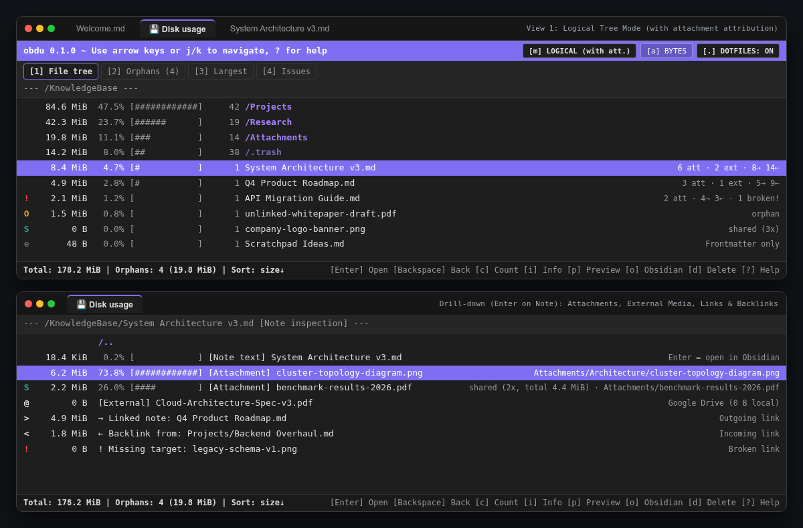

# Vault Disk Usage (obdu)

A lightweight Obsidian plugin (**0 runtime dependencies**, compatible with Desktop & Android) inspired by Linux `ncdu`, built to understand notes, embedded attachments, references, orphaned files, and `.trash`.



## Features

- **Authentic `ncdu` experience in a dedicated tab:** Fully keyboard-driven (`↑`/`↓`, `j`/`k`, `Enter`/`→`/`l`, `Backspace`/`←`/`h`, `s`/`n`/`C`/`M`, `c`, `g`, `m`/`Tab`, `a`, `.`/`e`, `1`–`4`, `/`, `i`, `o`, `f`, `p`/`Space`, `d`, `r`, `?`, `q`) with full mouse and Android touch support.
- **Two size attribution modes (`m` / `Tab`):**
  - **Physical:** Exact file and folder sizes at their physical location (including `.obsidian` & `.trash`).
  - **Logical (with Attachments, byte-neutral):** Attributes referenced local attachments proportionally to their owning notes (`S` flag on shared files), while leaving only unreferenced **orphaned** files with weight inside attachment folders—conserving total vault size to the exact byte.
- **Drill-down into Notes & Attachments (`Enter`):** Opening a note reveals its own text weight, referenced local attachments, external Google Drive / web media embeds (`0 B` locally), outgoing note links (`→`), incoming backlinks (`←`), and broken references (`!`). Opening an attachment lists all notes referencing it, allowing instant multi-hop navigation.
- **Global diagnostic views (`1`–`4`):** Switch instantly between `1` File Tree, `2` Orphans sorted by size (toggleable across `Attachments` / `Notes` / `All` via `t`), `3` Largest Files across the vault, and `4` Broken Links & Empty Items.
- **Smart Delete (`d`):** Safely moves items to `.trash/<relative-path>` preserving folder structure (with optional permanent delete), offers cascade deletion of exclusive attachments (cleaning up newly emptied per-note attachment subfolders), protects shared attachments, and warns before breaking incoming backlinks.

## Keyboard Shortcuts

| Key(s) | Action |
| :--- | :--- |
| `↑` / `↓`, `k` / `j`, `PgUp` / `PgDn`, `Home` / `End` | Navigate rows |
| `Enter`, `→`, `l` | Open directory, inspect note references, or inspect attachment owners |
| `Backspace`, `←`, `h` | Navigate back in history / parent folder |
| `m`, `Tab` | Toggle **Physical** ↔ **Logical (with Attachments)** size mode |
| `a` | Toggle **Apparent Size** (bytes) ↔ **Disk Blocks** (`4 KiB`) |
| `.`, `e` | Show / hide system & dot folders (`.obsidian`, `.trash`, `.git`) |
| `c` | Show / hide item-count column |
| `g` | Cycle bar display (`[% + #####]` → `[#####]` → `[%]` → `Hidden`) |
| `s` / `n` / `C` / `M` | Sort by Size, Name, Item Count, or Modified Time (press again to reverse) |
| `1` / `2` / `3` / `4` | Switch view (`1` Tree · `2` Orphans · `3` Largest · `4` Issues) |
| `t` *(in View 2)* | Cycle orphan filter (`Attachments` → `Notes` → `All`) |
| `/` | Live substring filter (`Esc` clears filter) |
| `i` | Item & reference info modal |
| `p`, `Space` | Quick preview modal (images, PDFs, Markdown/text) |
| `o` | Open selected file in a new Obsidian tab |
| `f` | Reveal in system file manager / Finder (Desktop) |
| `d` | Smart Delete dialog |
| `r` / `?` / `q` | Rescan vault / Keyboard help / Close tab |

## Development & Build

```bash
npm test
npm run build
```
